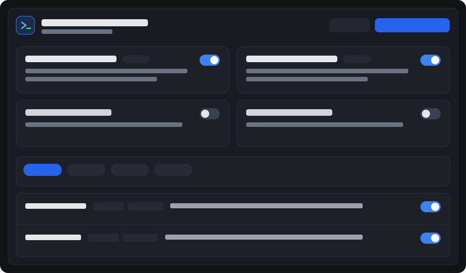

# Antigravity Mattpocock Skills

[简体中文](README.md) · **English**

[](LICENSE)
[](https://github.com/xinghaix/antigravity-plugins/actions/workflows/ci.yml)
[](https://github.com/xinghaix/antigravity-plugins/releases)

A native **Google Antigravity** migration of [mattpocock/skills](https://github.com/mattpocock/skills) bundled with an interactive **Mattpocock Skills** Sidecar Aux Pane UI.

- **English Prompt Precision + Bilingual Studio UI**: `SKILL.md` instructions keep Matt Pocock's original English wording (with targeted Antigravity native adaptations), while the Studio UI provides bilingual (`中 / EN`) summaries, faceted filters, side-by-side instruction previews, and one-click workspace delivery.
- **Zero External npm Dependencies**: Built purely with Node.js >= 20 standard library and `sidecar_sdk`.
- **MIT Licensed**: Preserves upstream MIT attribution in [NOTICE](NOTICE).



---

## Key Antigravity Native Adaptations

1. **Flat Single-Level Plugin Layout**: Compiles `skills/<bucket>/<name>` into flat `skills/<name>/SKILL.md`, strips Codex-specific `agents/openai.yaml`, and keeps the plugin root free of `AGENTS.md` so `agy plugin validate --strict` passes with zero warnings.
2. **Native `read_file` Cross-Skill Calls**: Rewrites every `Call the Skill tool with "..."` directive into relative `read_file` pointers (`../<skill>/SKILL.md`), with automatic dependency resolution when toggling skills in the UI.
3. **Dedicated Leaf Subagents**: Ships 4 non-recursive subagents under `agents/` (`mp-standards-reviewer`, `mp-spec-reviewer`, `mp-researcher`, `mp-explorer`) so `research` has live `search_web` + `write_file` access and two-axis `code-review` never enters recursive subagent loops.
4. **Native Shared Workspaces & Plan Mode Handoff**: Maps `implement-spec` parallel execution to `invoke_subagent(TypeName: "self", Workspace: "share")`, adds Generative UI Artifact guidance to `improve-codebase-architecture` & `prototype`, and handles Antigravity Plan/Execute mode handoffs cleanly.

---

## Installation

### Prerequisites
- **Google Antigravity** (Desktop or IDE)
- **Node.js >= 20.0.0**

### Remote Single-Plugin Install (No Full Clone)

```bash
curl -fsSL https://raw.githubusercontent.com/xinghaix/antigravity-plugins/main/install.sh | bash -s -- mattpocock-skills
```

### Install from Monorepo (Defaults to `--link`)

```bash
git clone https://github.com/xinghaix/antigravity-plugins.git
cd antigravity-plugins

# Default symlink install into ~/.gemini/config/plugins/mattpocock-skills
node scripts/cli.mjs install mattpocock-skills
# Or standalone copy: node scripts/cli.mjs install mattpocock-skills --copy
```

Use `node scripts/cli.mjs install --copy` (or switch inside the Studio **Sync & Settings** tab) for a standalone copy that supports untracked global dynamic skill toggling without modifying your git working tree. You can also deliver any skill subset directly into `<workspace>/.agents/skills/` from the **Workspace Hub**.

Open the Studio panel in Antigravity via `[Mattpocock Skills](sidecar://mattpocock-skills/mp_studio/)`.

### Development & Verification

```bash
npm run sync:upstream
npm run check
npm test
npm run pack:release
```

## License

[MIT License](LICENSE). Derived skills retain upstream MIT attribution to Matt Pocock ([NOTICE](NOTICE)).
