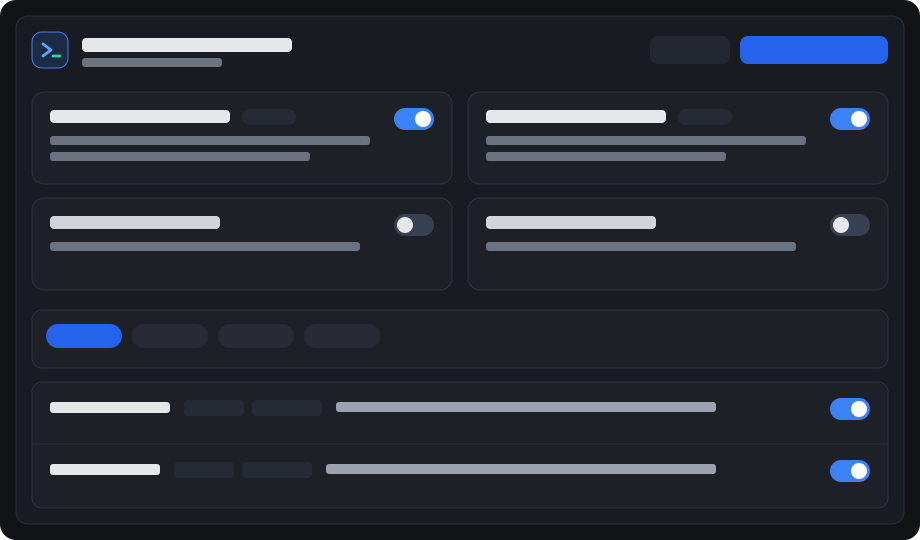

# Antigravity Mattpocock Skills

**简体中文** · [English](README.en.md)

[](LICENSE)
[](https://github.com/xinghaix/antigravity-plugins/actions/workflows/ci.yml)
[](https://github.com/xinghaix/antigravity-plugins/releases)

将 [mattpocock/skills](https://github.com/mattpocock/skills)（Matt Pocock 的工程与生产力技能集）**原生迁移**至 **Google Antigravity**（桌面端与 IDE），并配备挂在客户端右侧辅助面板（Aux Pane）的 **Mattpocock Skills** 可视化工作台。

- **指令保留英文，UI 全中文/双语导读**：给模型阅读的 `SKILL.md` 保留原版英文语义精度并完成 Antigravity 原生原语编译；右侧 Studio 面板提供中英双语切换、分桶开关、二级场景多选、源码对照预览与一键投递。
- **零外部 npm 依赖**：纯 Node.js >= 20 标准库 + `sidecar_sdk` 实现。
- **MIT 开源协议**：沿用上游 MIT 协议并在 [NOTICE](NOTICE) 保留 Matt Pocock 署名。



---

## 相比直接搬运，做了哪些 Antigravity 原生化改造？

1. **目录展平与清单对齐**：将上游二级分桶 `skills/<bucket>/<name>` 自动编译展平为 Antigravity 单层 `skills/<name>/SKILL.md`，剔除 Codex 专属 `agents/openai.yaml`，并保持插件根目录无 `AGENTS.md` 冲突（通过 `agy plugin validate --strict` 零告警）。
2. **消除 `Skill tool` 幻觉**：将所有 `Call the Skill tool with "..."` 编译替换为 Antigravity 原生的相对路径 `read_file` 指针（`../<skill>/SKILL.md`），并在 UI 开关切换时自动联动启用依赖技能。
3. **专用叶子子代理（防断网、防递归）**：新增 4 个受限原生子代理（`agents/mp-standards-reviewer.md`、`agents/mp-spec-reviewer.md`、`agents/mp-researcher.md`、`agents/mp-explorer.md`），修复内置 `research` 子代理无网只读问题，并从工具权限层面杜绝 `/code-review` 子代理递归重入。
4. **原生并发 Worktree 与 Plan Mode 衔接**：`implement-spec` 映射到 `invoke_subagent(..., Workspace: "share")`；`improve-codebase-architecture` 与 `prototype` 原生支持 Antigravity Generative UI Artifact 渲染；涉写盘的面试型技能自动提示在落盘前先 `exit_plan_mode`。

---

## Sidecar 可视化控制台（`sidecar://mattpocock-skills/mp_studio/`）

1. **技能编排 (`Skills`)**：
   - **2x2 分桶卡片开关**：`Engineering (20)`、`Productivity (7)`、`In-Progress (8)`、`Misc (4)` 一键启停，支持「标准 27 / 精简主干 / 全量」预设包。
   - **多维筛选与内联预览**：按分桶、触发方式（用户命令 / 自动加载）、启用状态、7 大二级场景（采访与建模、架构与原型、规格与领航、TDD 与实施、审查与门禁、交接与自动化、教学与写作）筛选；点击「预览」同屏对比 **Antigravity 原生指令** 与 **上游原版** 及附属文档。
2. **流程领航 (`Workflow`)**：可视化 Idea → Ship 主干流、三大入口（`Triage` / `Diagnosing-Bugs` / `Wayfinder`）及上下文阶段边界速查。
3. **项目工作台 (`Workspace Hub`)**：
   - **一键投递到 `.agents/skills/`**：支持将全局已启用技能或单个技能复制/软链接到指定项目，团队克隆即可使用。
   - **可视化仓库初始化**：图形化替代 `/setup-matt-pocock-skills` 多轮对话，一键生成 `docs/agents/*.md`、写入 `AGENTS.md` 或 `.agents/rules/mattpocock-skills.md`（写入前自动创建快照备份，支持随时回滚）。
   - **`.scratch` 票据前沿看板**：自动解析 `.scratch/*/issues/*.md` 的 `Blocked by` 依赖边，分列展示 Ready Frontier / Blocked / Done。
4. **同步与设置 (`Sync & Settings`)**：在线检查并同步上游 `mattpocock/skills` 最新提交与版本、切换 `--link` / `--copy` 安装模式、恢复配置备份。

---

## 安装与使用

### 前置要求
- **Google Antigravity**（支持插件与 Sidecar Aux Pane）
- **Node.js >= 20.0.0**

### 单行远程直装（免克隆全仓）

```bash
curl -fsSL https://raw.githubusercontent.com/xinghaix/antigravity-plugins/main/install.sh | bash -s -- mattpocock-skills
```

### 从 Monorepo 源码安装（默认 `--link` 软链接模式）

```bash
git clone https://github.com/xinghaix/antigravity-plugins.git
cd antigravity-plugins

# 默认以 --link 软链接模式安装到 ~/.gemini/config/plugins/mattpocock-skills
node scripts/cli.mjs install mattpocock-skills
# 或复制模式：node scripts/cli.mjs install mattpocock-skills --copy
```

> **关于 `--link` 与 `--copy` 两种模式**：
> - **`--link`（默认）**：适合跟随源码/上游同步，直接软链接仓库到 `~/.gemini/config/plugins/mattpocock-skills`。在 UI 中切换全局技能开关会实时同步到仓库 `skills/` 目录；如不想改动仓库工作区，可通过 UI 的 **「投递到项目」** 功能按需投递到具体项目的 `.agents/skills/`。
> - **`--copy`**：使用 `node scripts/cli.mjs install --copy`（或在 UI「同步与设置」一键切换），将插件独立复制到 `~/.gemini/config/plugins/mattpocock-skills`，支持完全不污染仓库 Git 的**全局无痕动态技能开关**。

安装完成后，在 Antigravity 插件中心确认启用 `mattpocock-skills`（或重启客户端），即可在对话中通过 `[Mattpocock Skills](sidecar://mattpocock-skills/mp_studio/)` 打开面板，或直接使用 `/ask-matt`、`/grill-with-docs` 等技能。

### 卸载
```bash
./uninstall.sh   # 或 node scripts/cli.mjs uninstall
```

---

## 常用开发命令

```bash
# 从 GitHub 同步最新 mattpocock/skills 并重新编译适配
npm run sync:upstream

# 语法、清单、死链与 agy plugin validate --strict 检查
npm run check

# 运行自动化测试
npm test

# 构建 Release 压缩包 (dist/release/)
npm run pack:release
```

---

## 致谢与协议

- 上游技能来源：[mattpocock/skills](https://github.com/mattpocock/skills)（MIT License，作者 Matt Pocock）。
- 本项目基于 [MIT License](LICENSE) 开源。
