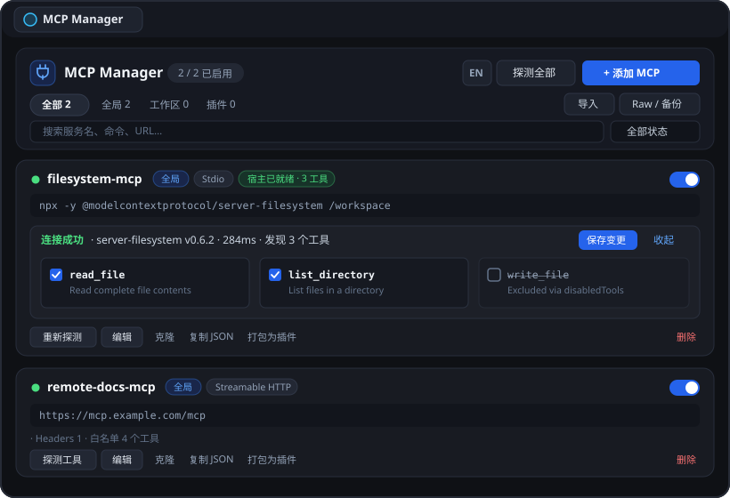

# Antigravity MCP Manager

[简体中文](README.md) · **English**

[](https://github.com/xinghaix/antigravity-plugins/actions/workflows/ci.yml)
[](https://github.com/xinghaix/antigravity-plugins/releases)
[](LICENSE)

A zero-dependency visual **MCP (Model Context Protocol)** server manager plugin for **Google Antigravity** (Desktop & IDE). Runs natively inside Antigravity's auxiliary side pane (`Aux Pane`) with automatic light/dark theme synchronization.



---

## Features

- **Unified Multi-Scope Management**: View and manage Global (`~/.gemini/config/mcp_config.json`), Workspace (`<project>/.agents/mcp_config.json`), and Plugin-bundled MCP servers in one place, with cross-scope migration and duplicate-name conflict detection.
- **Host Runtime Integration**: Reads Antigravity Language Server's `GetMcpServerStates` to show live `Host Ready` status badges and loaded tool counts directly on server cards.
- **Live Protocol Probe (Single & Batch)**: Handshakes with local **Stdio** (macOS/Linux/Windows `PATHEXT` & `.cmd`/`.bat` aware) and remote **Streamable HTTP** servers (`initialize` + `tools/list`), displaying latency, server version, and interactive tool lists.
- **Visual Tool Filtering**: Toggle tool checkboxes inside the probe drawer and save back cleanly as `enabledTools` (allowlist) or `disabledTools` (denylist).
- **Dual-Mode Editor & Snippet Importer**: Built-in templates (`Filesystem`, `Fetch`, `GitHub`, `SQLite`, `Remote HTTP`, `SSE Bridge`), one-click command splitter, secret masking, Form/JSON two-way sync, server cloning, and snippet import compatible with Antigravity, Claude Desktop, Cursor, and VS Code (`servers` / `serverUrl`).
- **Atomic Writes & Backup Restore**: Every write uses atomic temp-file replacement (`0600`) and retains up to 15 automatic backups that can be restored in one click from the `Raw / Backups` modal.
- **One-Click Plugin Packaging**: Export any MCP server into a standalone `~/.gemini/config/plugins/<slug>/` plugin bundle for independent toggling.
- **Bilingual UI & Shortcuts**: Instant `EN / 中` toggle in the header, `/` or `Cmd/Ctrl+K` to search, and `Cmd/Ctrl+S` to save open modals.

---

## Installation

### Prerequisites
- **Google Antigravity** (with plugin & Sidecar Aux Pane support)
- **Node.js >= 20.0.0** (zero external npm dependencies)

### Option 1: Single-Plugin Remote Install (No Full Clone)
```bash
curl -fsSL https://raw.githubusercontent.com/xinghaix/antigravity-plugins/main/install.sh | bash -s -- mcp-manager
```

### Option 2: Install via AI Agent
Ask Antigravity directly:
> "Read `AGENTS.md` in `https://github.com/xinghaix/antigravity-plugins` and install the `mcp-manager` plugin."

### Option 3: Install from Monorepo Source

```bash
git clone https://github.com/xinghaix/antigravity-plugins.git
cd antigravity-plugins

# Symlink install (default, follows git updates):
node scripts/cli.mjs install mcp-manager

# Or standalone copy:
# node scripts/cli.mjs install mcp-manager --copy
```

Restart Antigravity (or toggle the plugin in Customizations), then open `[MCP Manager](sidecar://mcp-manager/mcp_manager/)`.

### Uninstall
```bash
./uninstall.sh          # macOS / Linux
# uninstall.bat         # Windows
# or: node scripts/cli.mjs uninstall
```
> Uninstalling removes only the plugin folder and keeps your `~/.gemini/config/mcp_config.json` intact.

---

## Development & Testing

```bash
# Run syntax, manifest, and strict layout checks
npm run check

# Run unit tests
npm test

# Validate with Antigravity CLI
agy plugin validate ~/.gemini/config/plugins/mcp-manager --strict --json

# Build release archives (.zip, .tar.gz, SHA256SUMS.txt)
npm run pack:release
```

---

## License

Licensed under the [MIT License](LICENSE).
