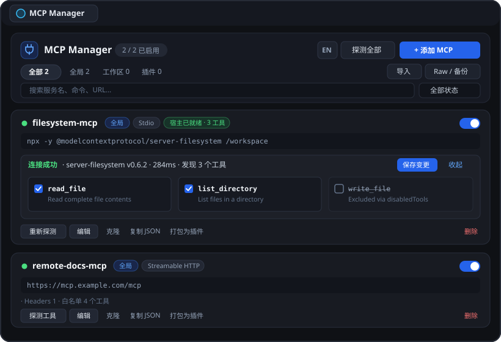

# Antigravity MCP Manager

**简体中文** · [English](README.en.md)

[](https://github.com/xinghaix/antigravity-plugins/actions/workflows/ci.yml)
[](https://github.com/xinghaix/antigravity-plugins/releases)
[](LICENSE)

为 **Google Antigravity**（桌面端与 IDE）打造的可视化 MCP（Model Context Protocol）管理插件，直接挂载在客户端右侧辅助面板（Aux Pane），提供零依赖、深浅主题自适应的 MCP 全生命周期管理体验。



---

## 核心特性

- **多作用域统一视图**：一站式管理全局（`~/.gemini/config/mcp_config.json`）、项目工作区（`<workspace>/.agents/mcp_config.json`）以及已安装/内置插件附带的 MCP 服务，支持跨作用域迁移与同名冲突告警。
- **宿主运行时状态直连**：自动读取 Antigravity Language Server 的 `GetMcpServerStates`，在卡片上直接展示 `宿主已就绪` 与已加载工具数，点击即可零等待展开工具列表。
- **实时协议探测（Live Probe）**：支持单个或一键**探测全部**本地 Stdio（含 Windows `.cmd`/`.bat` 与 `PATHEXT`、nvm/Homebrew/Cargo/Bun 等多路径自动解析）和远程 Streamable HTTP 服务，展示握手耗时、服务端版本与完整工具清单。
- **可视化工具粒度过滤**：在探测抽屉中直接勾选/取消工具，支持按原有 `enabledTools`（白名单）或 `disabledTools`（黑名单）语义保存过滤配置，减少上下文冗余。
- **双模式编辑 & 兼容导入**：内置 `Filesystem` / `Fetch` / `GitHub` / `SQLite` / `Remote HTTP` / `SSE Bridge` 快捷模板、整行命令一键拆解、密码遮罩切换、表单/JSON 双向同步、克隆服务，以及一键导入 Antigravity / Claude Desktop / Cursor / VS Code（`servers` / `serverUrl`）配置片段。
- **安全写入与历史备份恢复**：所有写入均采用临时文件原子替换（权限 `0600`）并保留最近 15 份自动备份，可在 `Raw / 备份` 面板一键格式化或回滚。
- **一键打包为独立插件**：可将任意 MCP 服务导出为 `~/.gemini/config/plugins/<slug>/` 下的独立插件包，方便在插件中心按需开关。
- **中英双语 & 键盘快捷键**：支持界面右上角 `EN / 中` 实时切换，支持 `/` 或 `Cmd/Ctrl+K` 搜索、`Cmd/Ctrl+S` 保存弹窗。

---

## 安装指南

### 前置要求
- **Google Antigravity**（支持插件与 Sidecar Aux Pane）
- **Node.js >= 20.0.0**（零外部 npm 依赖，纯 Node.js 标准库实现）

### 方式一：单行远程直装（免克隆全仓，推荐用户使用）
```bash
curl -fsSL https://raw.githubusercontent.com/xinghaix/antigravity-plugins/main/install.sh | bash -s -- mcp-manager
```

### 方式二：给 AI 智能体的一句话安装指令
直接在 Antigravity 对话中发送：
> “读取 `https://github.com/xinghaix/antigravity-plugins` 的 `AGENTS.md`，帮我安装 `mcp-manager` 插件并用 `agy plugin validate` 校验。”

### 方式三：从 Monorepo 源码安装（推荐开发者使用）

```bash
git clone https://github.com/xinghaix/antigravity-plugins.git
cd antigravity-plugins

# 默认 --link 软链接安装到 ~/.gemini/config/plugins/mcp-manager：
node scripts/cli.mjs install mcp-manager
# 或独立复制模式：node scripts/cli.mjs install mcp-manager --copy
```

安装完成后重启 Antigravity（或在插件中心切换开关），即可在右侧面板或对话中使用 `[MCP Manager](sidecar://mcp-manager/mcp_manager/)` 打开。

### 卸载
```bash
./uninstall.sh          # macOS / Linux
# uninstall.bat         # Windows
# 或 node scripts/cli.mjs uninstall
```
> 卸载仅移除插件目录，不会删除你的 `~/.gemini/config/mcp_config.json`。

---

## 目录结构

```text
antigravity-mcp-manager/
├── plugin.json                  # Antigravity 插件清单
├── package.json                 # npm 元数据与脚本入口
├── assets/
│   ├── logo.svg                 # 插件图标
│   └── preview.svg              # 面板预览图
├── skills/mcp-manager/
│   └── SKILL.md                 # 对话触发与 sidecar:// 导航技能
├── sidecars/mcp_manager/
│   ├── sidecar.json             # Sidecar Aux Pane 注册配置
│   ├── main.mjs                 # SidecarApp HTTP 路由与宿主状态桥接
│   ├── mcp_store.mjs            # 多作用域读写、备份恢复、插件导出与命令解析
│   ├── mcp_probe.mjs            # Stdio / Streamable HTTP 协议探测客户端
│   ├── index.html               # 主界面与弹窗结构
│   ├── styles.css               # 原生主题变量自适应样式
│   └── app.js                   # 前端交互与中英双语 i18n
├── scripts/
│   ├── cli.mjs                  # 跨平台安装/卸载/状态 CLI
│   ├── check.mjs                # 语法、版本一致性与插件规范校验
│   └── package-release.mjs      # 零依赖 Release 打包器 (.zip / .tar.gz / SHA256SUMS)
└── tests/
    └── mcp_manager.test.mjs     # 自动化单元测试套件
```

---

## 开发与测试

```bash
# 语法、清单与严格规范检查
npm run check

# 运行单元测试
npm test

# 使用 Antigravity 官方 CLI 严格校验
agy plugin validate ~/.gemini/config/plugins/mcp-manager --strict --json

# 构建发布压缩包（输出到 dist/release/）
npm run pack:release
```

---

## 开源协议

本项目基于 [MIT License](LICENSE) 开源。
